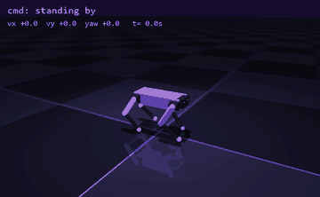
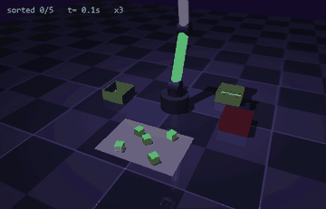
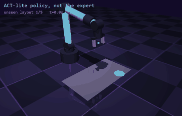
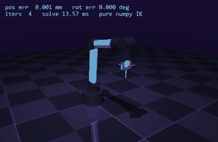

  

  
  

**Founder of [Athena Labs](https://www.athenaa.xyz/).** Physical AI that doesn't start at $15,000: robot arms and rugged edge AI computers for schools, labs and industry, designed and built in Almaty.

**Building [Tetsu](https://trytetsu.com).** Describe it, build it: from one sentence to real CAD, wiring and firmware for robots and hardware.

First exit at 15 ($50k). Math olympiad. Into AI, robotics, physical AI, startups and venture.

  

## Research

**[SUSS](https://github.com/nonberw/suss): What a Transformer Learns When It Adapts to Unknown Physics In-Context.** A pre-registered mechanistic study. Small transformers are Bayes-optimal while data are scarce, the mechanism I pre-registered (an estimate in the residual stream) is not there, and the sufficient statistics turn out to live in the attention key-value memory: swapping only those keys and values between episodes moves 91-94% of the behaviour. Also MuJoCo contact physics and an in-context controller that learns to explore.
[Paper](https://github.com/nonberw/suss/blob/main/paper/main.pdf) · [Project page](https://nonberw.github.io/suss/) · [DOI 10.5281/zenodo.24031898](https://doi.org/10.5281/zenodo.24031898)

**[LISTEN](https://github.com/nonberw/listen): When Do Robot Policies Learn to Listen?** A controlled, pre-registered study of why language-conditioned robot policies ignore their instructions. Holding the data budget, expert and architecture fixed and raising only the share of scenes demonstrated with several instructions from 0 to 0.5 lifts counterfactual instruction following from 48.9% to 71.3%.
[Paper](https://github.com/nonberw/listen/blob/main/paper/main.pdf) · [Project page](https://nonberw.github.io/listen/) · [DOI 10.5281/zenodo.24041281](https://doi.org/10.5281/zenodo.24041281)

## Robot learning from scratch

No RL libraries, no IK packages, no OpenCV, no pretrained models: the interesting parts are written by hand, then measured.

  
  
  
  

| Project | What it is | Headline |
|---|---|---|
| [ARMageddon](https://github.com/nonberw/armageddon) | inverse kinematics for a 6-DoF arm in pure NumPy | 99.6% of 500 random 6D poses, about 0.7 ms per solve |
| [YOINK](https://github.com/nonberw/yoink) | vision-based pick-and-place: RGB-D cube detection, friction grasping | 810 of 810 cubes sorted, every one on the first grab |
| [COPYCAT](https://github.com/nonberw/copycat) | imitation learning: scripted expert, DART noise, BC vs action chunking | with 200 demos: ACT-lite 98%, chunked MLP 100%, plain BC 82% |
| [ZOOMIES](https://github.com/nonberw/zoomies) | a quadruped I designed plus PPO written from scratch, 1024 robots in parallel | walks in about 20 minutes, survives a 1.5 m/s kick 93% of the time |
| [SPUD](https://github.com/nonberw/spud) | Isaac-lite for weak laptops: layer streaming and huge simulations | a 2B-parameter model in 0.5-0.65 GB of VRAM; 65,536 robots walking at once |

## Out in the world

- **[WetlandEar](https://wetlandear.tech)**: open acoustic monitoring for nature reserves in Kazakhstan. The species classifier ([wetlandear-ml](https://github.com/nonberw/wetlandear-ml)) gets 74.2% per 3-second clip and 85.0% per recording across 268 species, against 56.3% for BirdNET on its own.
- **[365step](https://github.com/nonberw/365step)**: an EdTech app for SAT, IELTS, ENT and programming, with an AI tutor.

## How I work

- Hypotheses and tests go in a commit before the main experiments run. What failed stays in the paper.
- Every number should be traceable to a results file the code wrote, not to my memory.
- If it doesn't run on a 4 GB laptop, it doesn't ship. The laptop has opinions about this and falls asleep mid-run to share them.

<picture>
  <source media="(prefers-color-scheme: dark)" srcset="https://raw.githubusercontent.com/nonberw/nonberw/output/snake-dark.svg">
  <source media="(prefers-color-scheme: light)" srcset="https://raw.githubusercontent.com/nonberw/nonberw/output/snake.svg">
  
</picture>
